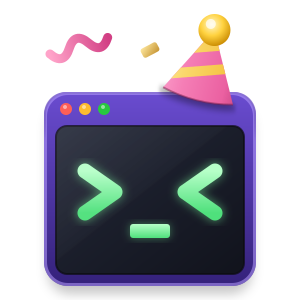

<h1 align="center">ptyparty</h1>

Hi! Welcome to the `ptyparty`!

This is [@qxjit](https://github.com/qxjit) (a human) typing.

It can be a sad experience working with coding agents in the terminal these days, but
it doesn't have to be. We can make it a party instead!

Here are some (very experimental) tools that we are working on with copious agent
help to try to make it more enjoyable and productive. Each can be used successfully
on its own, but they work best together as a suite. Together, they let you run a Claude
session in the background that is aware of the other applications running alongside it. You
can do this for multiple tabs, with one Claude running per tab.

Like this:

This shows a layout in `qmux` that has `quoll` (a terminal markdown browser) on the left,
`remax` (a code review tool) on the right. Claude is running in the background and is prompted
directly via `qmux`, asks questions through `qmux` and interacts with `quoll` and `remax`.

So, here are the tools. These are considered *highly experimental*, and are changing very
quickly at the moment, so please keep that in mind. You don't have to use `qmux` to use
any of them either!

## The crew

| | | |
|---|---|---|
|  | **[qmux](https://github.com/ptyparty/qmux)** | A terminal multiplexer that agents can interact with |
|  | **[quoll](https://github.com/ptyparty/quoll)** | A markdown viewer that you can use to iterate on design with an agent |
|  | **[remax](https://github.com/ptyparty/remax)** | A code review focused editor that lets you review code diffs hunk by hunk |
|  | **[kowari](https://github.com/ptyparty/kowari)** | A PostgreSQL client for the terminal designed to be used alongside an agent |

## Getting started

There's a README in each repo that you can follow for setup. Expect it to be rough right
now, as things are not polished.
